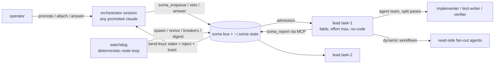

# claude-soma-lite: design

Status: draft, awaiting operator review.
Date: 2026-07-29.
Inputs: four research deep-reads (`research/01..04-*.md`), a three-architect design panel with an adversarial judge and a gap critic (working papers that are not published). This spec is the judge's winning design (B, operations-first) with the judge's grafts and the critic's fixes merged in, so it stands on its own.

## 1. What it is

claude-soma-lite turns any Claude Code session on a local machine into the orchestrator of an agent fleet. The operator says once: "work on these 10 backlog items." The system fans each item out to its own project lead (an independent Claude Code session in its own tmux session and git worktree), governs how many run at once so a single Claude Max subscription survives, and reports back through desktop notifications and a digest of draft PRs. Leads plan but never code: each lead picks a loop harness for its task, then drives an agent team (split tmux panes) for all edits and dynamic workflows for read-side fan-out.

It is a subset of claude-soma rebuilt for a machine the operator is sitting at: no Telegram channel, no voice, no dashboard, no file dropper, no systemd. tmux is the supervisor, the display, and the wake channel. The operator's window into everything is `tmux -L soma attach` plus notifications.

The operator loop, end to end: `/soma:promote` (or `soma orch`) -> "work on these 10 backlog tickets" -> the orchestrator queries Jira through its existing Atlassian MCP and calls `soma_enqueue` -> walk away. Days later: a toast, a digest, ten draft PRs, comment-only Jira writeback. In between: `soma status`, or attach to any lead and just type.

## 2. Goals and non-goals

Goals: fan out a backlog without per-ticket prompting; survive crashes, rate-limit storms, and orchestrator death without babysitting; keep every hard rule mechanical where the platform allows; stay small enough to read in a sitting.

Dropped from claude-soma (non-goals): messaging channels, voice pipeline, social posting, FastAPI/Next.js dashboard, file dropper, cgroup isolation, multi-VPS, any web surface. Never planned: native Windows (WSL2 is the Windows story, section 14).

## 3. Requirements

Hard requirements from the operator:

1. Minimal local clone of claude-soma, operator at the GUI.
2. tmux as the substrate for leads; direct attach/peek.
3. Leads talk back to the orchestrator via MCP.
4. Any Claude Code session can be promoted to orchestrator on demand, including adopting a running fleet.
5. Leads use dynamic workflows for parallelizable work.
6. Leads run agent teams (split-pane tmux teammates) for the coding.
7. Leads decide a loop harness as their first action on receiving a task and report it.
8. Leads never code. They are pinned to model fable and effort max. Non-negotiable.
9. Cross-platform: macOS and Linux first-class, Windows via WSL2.
10. Ten-item fan-out from one prompt, governed against one Max subscription.

Standing operator rules baked into mechanics: one git worktree per task, never the shared checkout; PRs are draft-only, agents never merge or mark ready; Jira writeback is comment-only, never a transition.

## 4. Shape of the system

Five roles. The operator owns decisions the fleet cannot make. The orchestrator (any promoted session) does intake, dispatch, vetoes, answers, and writeback; it burns tokens only on decisions. The watchdog (a detached deterministic Node loop, not an LLM) does all cadence work: reconcile, revive, stall detection, budget breakers, backpressure, queue drain, digest trigger. Leads (one per task, fable/max, planning-locked) choose harnesses, plan, and delegate. Teammates and workflow agents are the hands: teammates edit, workflow agents read.

| Component | Kind | Rough size |
|---|---|---|
| `bin/soma-bus.mjs` | stdio MCP server, role-gated tools, lease logic, wake | ~700 LOC |
| `bin/lib/*.mjs` | fleet state, events, tmux wrappers, spawner, worktrees, pre-trust, notify, token accounting | ~900 LOC |
| `bin/soma-watchdog.mjs` | 30 s tick loop, detached in its own tmux session | ~550 LOC |
| `bin/soma.mjs` | operator CLI: `init up down status attach peek send enqueue retry kill resume hold release gc doctor digest thaw` | ~500 LOC |
| `bin/hooks/` | `orch-inject.mjs` (UserPromptSubmit), `lead-stop.mjs` (Stop), `lead-gate.mjs` (PreToolUse), `lead-postcompact.mjs` (PostCompact) | ~260 LOC |
| `bin/soma-pr.mjs` | the only allowed PR-creation path; always passes `--draft` | ~40 LOC |
| `prompts/` | `lead.md`, `orchestrator.md`, `harnesses.yaml` (H1-H6) | ~400 lines |
| `~/.claude/skills/soma-promote/` | promotion skill | ~60 lines |

Total around 3k LOC of dependency-free Node (hand-rolled newline JSON-RPC for MCP; no npm installs) plus prompts. Zero resident daemons beyond the watchdog loop inside tmux. The Node floor is 24, the latest LTS (decision D6), which makes `node:sqlite` available; the state layer still uses NDJSON files for v1 because single-writer lock-free appends and rebuildability are the design, not a workaround.

Runtime state under `~/.soma/` (inside WSL on Windows):

```
~/.soma/
  soma.json                  # config: max_leads, stagger_s, budgets, notify_policy,
                             # teammate_effort, repos{base_branch, verify_hint}, tested claude range
  state/fleet.json           # checkpoint (queue rows, leads, last_spawn_at); fleet.lock guards writes
  state/orch.lease           # {session_id, tmux_socket, tmux_pane, wake, lease_seq, heartbeat_at}
  state/backpressure.json    # {active, reason, evidence, since, until, ignore_lines[]}
  state/last-wake            # mtime = wake debounce
  events/<lead>.ndjson       # single writer: that lead's bus process
  events/orch.ndjson         # orchestrator + watchdog actions, incl. WRITEBACK_* ledger
  events/.cursors.json       # read cursors keyed by ROLE ("orch"), not session id
  heartbeats/<lead>          # touch file, mtime = last tool activity
  leads/<lead>/              # meta.json, mcp.json, settings.json, brief.md, HOLD, BUDGET_TRIPPED
  logs/<lead>.log            # pipe-pane transcript from birth
  worktrees/<repo>/<task>/   # one worktree per task
  digests/YYYY-MM-DD.md
```

Write discipline: every NDJSON file has exactly one writer, so appends are lock-free. `fleet.json` is read-modify-write under `fleet.lock` with tmp+rename publishes, and it is a checkpoint, not truth: `tmux -L soma has-session` is the only liveness ground truth, and the checkpoint is rebuildable from events plus tmux reality.



## 5. Orchestrator promotion

The enabling move happens once, at `soma init`: the bus is registered at user scope in candidate role (`claude mcp add -s user soma node <abs>/bin/soma-bus.mjs -e SOMA_ROLE=candidate ...`) and the lease-gated inject hook is added to user settings. After that every interactive session already carries `soma_adopt` and read-only `soma_status`, so promotion needs no restart and no mid-session MCP mounting.

The menu (requirement 4 asked for options; all entry points sit on the same lease substrate, so they compose rather than compete):

| # | Mechanism | How it works | Verdict |
|---|---|---|---|
| P1 | `/soma:promote` skill | current session calls `soma_adopt`, prints fleet briefing, follows `orchestrator.md` | ship; best for "promote the session I am already in" |
| P2 | `soma orch` CLI | cold-starts a durable orchestrator in the soma tmux server (`--effort low`, orchestrator settings, auto-adopt on SessionStart) | ship; recommended for multi-day runs |
| P3 | `/mcp__soma__promote` MCP prompt | bus-exposed prompt, same effect as P1, zero skill install | ship, free once the bus exists |
| P4 | Hook auto-promotion (SessionStart grabs stale lease) | any random session silently owns the fleet | rejected: wrong session wins, too magical |
| P5 | `soma_adopt(force)` / `soma_release()` | mid-flight takeover and handoff of a running fleet | ship; this is the substrate P1-P3 use |

Recommendation: P2 for the standing overnight orchestrator, P1/P5 for grabbing a live fleet into whatever session the operator is in. P3 comes along for free.

Lease semantics. `state/orch.lease` records the holder's session id, tmux socket and pane (read from the bus's own environment at adopt time), a wake mode, and a monotonic `lease_seq`. Adoption rules: refuse when `SOMA_LEAD_NAME` is present in the caller's environment (poisons the whole lead process tree, teammates included); grant freely when the lease is absent, released, or its recorded pane no longer exists; otherwise require `force:true`. All lease mutations happen under `fleet.lock` as compare-and-swap on `lease_seq`, so two simultaneous promotions cannot both win. On a force-steal the bus send-keys a demotion notice to the old pane and appends a DEMOTED event, so the loser's inject hook stops feeding it. A session promoted outside tmux gets `wake:"notify"` and a plain warning: the fleet still runs, updates arrive as toasts and on the session's next turn.

If role upgrade via MCP `tools/list_changed` turns out not to be honored by the running Claude Code build (unverified; the canary tests it), the skill falls back to driving everything through `soma` CLI subcommands over Bash, which have full parity. Mutating CLI subcommands accept `--as <session_id>` and perform the same lease check when driven from a promoted session; bare human invocations print "acting as operator; lease held by X" instead of refusing.

## 6. The bus

Transport: stdio MCP, newline-delimited JSON-RPC 2.0, one file, zero dependencies. Config entries always use `"command": "node"` with an absolute forward-slash path, never `npx`. Role comes from `SOMA_ROLE`, identity from `SOMA_LEAD_NAME`; identity is never a tool parameter.

| Session | Mount | Visible tools |
|---|---|---|
| any user session | user-scope registration from `soma init` | candidate: `soma_adopt`, `soma_status` (read-only) |
| promoted session / `soma orch` | same mount, role upgraded after adopt | orchestrator: full control plane |
| lead | `--mcp-config ~/.soma/leads/<name>/mcp.json` + `--strict-mcp-config` | lead: report tools only |
| teammates | load user scope from disk (candidate bus); `soma_adopt` refuses them via inherited `SOMA_LEAD_NAME`; all other user-scope MCP servers are denied by the worktree settings (section 9) | effectively none |

Orchestrator tools: `soma_adopt(force?)`, `soma_release()`, `soma_enqueue(tasks[])`, `soma_queue(pause|resume|status)`, `soma_spawn(task_id)`, `soma_status(lead?)` (rows include harness, heartbeat age, turns, est tokens, budget %, PR URL, tmux target, model, and a `team:[{title, dead}]` field from live pane enumeration), `soma_inbox(mark_read?, limit?)`, `soma_send(lead, message)`, `soma_kill(lead, reason)`, `soma_resume(lead, force?)`, `soma_transcript(lead, lines?)`, `soma_digest()`.

Lead tools: `soma_report(type, payload)` with `type` in STARTED | HARNESS | MILESTONE | NEEDS_INPUT | COMPLETED | ERROR; `soma_task()` for re-orientation after resume or compaction; `soma_checkpoint(note)` as a cheap progress marker that doubles as a heartbeat. Payload validators and field limits are ported from soma (summary <= 2000 chars, question <= 500, at most 10 paths/urls). The watchdog writes synthetic events in the same schema: STALLED, REVIVED, GAVE_UP, BUDGET, BACKPRESSURE, BACKPRESSURE_RECOVERED, TEAMMATE_DOWN, MODEL_DEVIATION, HARNESS_DEFAULTED, CLAUDE_UPDATED, ORCH_ABSENT, FLEET_SETTLED, FLEET_DRAINED, DEMOTED, WRITEBACK_OK, WRITEBACK_FAILED.

Waking the orchestrator. A lead's `soma_report` appends one NDJSON line, then calls wake(): read the lease; if `wake:"tmux"` and the global debounce file is older than 30 s, run two send-keys calls into the recorded pane (literal `-l` text, then Enter) with a content-bearing one-liner such as `[soma] 3 unread lead events (latest: task-1 COMPLETED). Call soma_inbox.` NEEDS_INPUT, ERROR, and COMPLETED wake immediately (debounced); everything else batches into the watchdog's next tick. Desktop toasts always fire for NEEDS_INPUT, ERROR, and terminal events even when the tmux wake succeeds. The user-scope UserPromptSubmit hook additionally injects a compact unread-events block into the lease-holding session's next turn (it compares its environment to the lease and exits silently in every other session; fail-open). Push, inject, and pull are three independent delivery paths; losing one degrades latency, never correctness.

Recursion guard, layered: role-gated tool listing (a lead's bus never exposes spawn or kill); `SOMA_LEAD_NAME` in the environment hard-refuses adopt and spawn for the lead and every child that inherits its env; leads run `--strict-mcp-config` so user-scope servers never load into them; teammates get user-scope MCP servers denied by generated settings (section 9); `soma doctor` asserts the drift rules (lead mcp.json contains exactly one server; no orchestrator-capable soma entry in user scope).

## 7. Lead lifecycle

Spawn recipe for task `task-1` on repo `myapp`, base `develop`. The spawner (library code, called by watchdog auto-spawn or `soma_spawn`) is the only spawn path, so the pins cannot be forgotten:

```bash
# 1. Same-repo safety: serialize on a per-repo lock, then fetch and base on the remote ref
#    (a stale local develop would fork every branch from an old base)
flock ~/.soma/state/repo-myapp.lock ...
git -C ~/code/myapp fetch origin develop
git -C ~/code/myapp worktree add \
    ~/.soma/worktrees/myapp/task-1 -b soma/task-1 origin/develop
# base SHA recorded in meta.json; retry policy: clean worktree + open PR -> reuse;
# dirty or closed -> archive, worktree remove --force, recreate branch soma/task-1-r2

# 2. Keep the guard file out of the PR without touching the repo's .gitignore
echo ".claude/" >> ~/code/myapp/.git/worktrees/task-1/info/exclude

# 3. Team-wide guardrails into the worktree: .claude/settings.local.json (section 9)

# 4. Pre-trust the cwd (atomic edit of ~/.claude.json: projects[cwd].hasTrustDialogAccepted=true),
#    otherwise a detached claude blocks forever on the trust dialog

# 5. Generate ~/.soma/leads/task-1/{mcp.json, settings.json, brief.md, meta.json}

# 6. Spawn: one shared tmux server, per-task session, scrubbed environment,
#    transcript piped from birth
tmux -L soma new-session -d -s lead-task-1 -c ~/.soma/worktrees/myapp/task-1 \
  env -i HOME="$HOME" PATH="$PATH" SHELL="$SHELL" TERM=xterm-256color LANG="$LANG" \
    SOMA_LEAD_NAME=task-1 SOMA_HOME="$HOME/.soma" \
    CLAUDE_CODE_EFFORT_LEVEL=max \
    CLAUDE_CODE_EXPERIMENTAL_AGENT_TEAMS=1 \
    CLAUDE_CODE_ENABLE_PROMPT_SUGGESTION=0 \
    DISABLE_AUTOUPDATER=1 \
  claude \
    --model fable \
    --effort max \
    --session-id <uuid4> \
    --name lead-task-1 \
    --permission-mode acceptEdits \
    --dangerously-skip-permissions \
    --setting-sources user,project,local \
    --settings "$HOME/.soma/leads/task-1/settings.json" \
    --mcp-config "$HOME/.soma/leads/task-1/mcp.json" \
    --strict-mcp-config \
    --disallowedTools "Edit,Write,NotebookEdit" \
    --append-system-prompt-file "$HOME/.soma/leads/task-1/standing.md" \
    --remote-control lead-task-1 \
    -- "$(cat ~/.soma/leads/task-1/brief.md)" \
  \; pipe-pane -O -o -t lead-task-1 "cat >> $HOME/.soma/logs/task-1.log"

tmux -L soma set-option -t lead-task-1 remain-on-exit on
# poll capture-pane 2 s x 30 s for the claude.ai/code session URL -> meta.json (phone deep-link)
```

Load-bearing notes. The `--` before the brief prevents variadic `--mcp-config` from swallowing it (soma regression). The `env -i` allowlist keeps the operator's exported API keys (OpenAI, ElevenLabs, and the rest of the login shell) out of every lead, teammate, and workflow agent; `soma.json` has a logged per-repo `env_allow[]` escape hatch, and the canary verifies claude's OAuth still works under a scrubbed environment. Effort max cannot persist in settings, so it is pinned twice: `--effort max` and `CLAUDE_CODE_EFFORT_LEVEL=max`, which outranks the operator's own persisted `effortLevel: low`. `--remote-control` is kept for its soma-documented keep-alive (leads otherwise exit after the first task) plus the free attach URL; the canary proves the behavior per Claude Code version, and the fallback is a Stop-hook keep-alive. Standing orders live in `--append-system-prompt-file` so auto-compaction on a long grind cannot eat them; the brief carries only the task packet. Single shared server `-L soma`: one inventory, one failure domain whose recovery equals reboot recovery; soma's per-lead servers existed only to dodge systemd cgroup teardown, which does not exist here.

Terminal lifecycle and slot release. The bus flips the task row on terminal events: COMPLETED -> done, ERROR/GAVE_UP -> failed, NEEDS_INPUT -> blocked. Admission counts only non-terminal, non-blocked leads, so a finished lead frees its slot immediately. The watchdog kills tmux-alive done leads after a `linger_minutes` grace window (default 45; session uuid retained for on-demand `soma_resume`). Blocked leads yield their admission slot after `blocked_slot_minutes` (default 120) while staying alive and answerable. Queue rows use the enum queued | spawned | done | failed | blocked | skipped; `soma retry <task>` re-queues failed rows through the idempotent worktree path.

Death and resume. Watchdog reconcile: registry-active but `has-session` false -> capture the death scene (remain-on-exit pane tail plus log tail) -> resume-first with `--resume <session_uuid>` in a fresh same-name tmux session, backoff 3 attempts / 1 h cooldown, then fresh spawn from the stored brief, then a single GAVE_UP event and toast. A resume is refused when estimated tokens exceed 200k (a context-saturated session would resume saturated); the watchdog fresh-spawns with the brief plus the last N events as a handoff instead. Teams do not survive resume: the resume prompt carries the last-known roster and instructs the lead to re-establish. A PostCompact hook injects "context compacted: call soma_task() and re-read your HARNESS contract" so a compacted lead re-orients itself.

## 8. Lead playbook

Step 0, before anything else: choose the loop harness. The intake table is mechanical, adapted from loop-engineering:

| Question | Harness |
|---|---|
| Ticket too vague to state a checkable "done"? | stop: `soma_report(NEEDS_INPUT)` before any work |
| Deliverable is a report/RCA/estimate, not code | H6 RESEARCH-SPIKE (read-only, workflows) |
| "Done" checkable by a runnable command, behavior specifiable test-first | H3 TDD-LOOP |
| Runnable gate exists at repo level (make CI/tests green) | H2 ITERATE-TO-GREEN |
| No mechanical gate captures correctness | H4 REVIEW-FIX-LOOP |
| Small, crisp, low-risk, single pass plausible | H1 ONE-SHOT-PIPELINE |
| A draft PR just opened (any harness) | attach H5 BABYSITTER-FOLLOWUP |

The registry (`prompts/harnesses.yaml`) keeps loop-engineering's schema and vocabulary (MIT, attributed) extended with soma-lite fields: shape (bounded|standing), iteration {mode, max_iterations, stagnation, no_progress}, verify {kind, command, independent}, stop_conditions, budget_class, and the implementing primitive (agent-team, workflow, in-session /loop, orchestrator watchlist).

Step 1: report it. `soma_report("HARNESS", {harness_id, autonomy, verify_command, max_iterations, budget_class, team_plan, plan_summary})`. This one event is simultaneously the plan of record and the budget reservation: the watchdog binds the lead's circuit breaker to the declared class, and the orchestrator holds a one-turn veto window before real work starts. A Stop hook blocks the lead's first idle until a HARNESS event exists (exit 2, at most 3 blocks); if the lead still fails to choose, the watchdog binds budget class `standard` and emits HARNESS_DEFAULTED so no lead ever runs breakerless.

Re-choice protocol: exactly one self-serve lateral or downgrade re-choice via a superseding HARNESS report (`supersedes:true`); consumed tokens carry forward and the veto window re-opens. Autonomy upgrades and H6-to-code changes require an orchestrator ACK or become NEEDS_INPUT. A third change is refused and becomes NEEDS_INPUT.

Step 2: plan without writing. The lead cannot Edit or Write. Its planning media are the team task list (TaskCreate/TaskUpdate, mechanical tools exempt from the code ban, persisted under `~/.claude/tasks/<team>/`) and report payloads. If a PLAN.md belongs in the worktree, a teammate writes it.

Step 3: run the team, the only hands. Teams are enabled by the env flag; `teammateMode` auto/tmux gives split panes inside the lead's window because the lead already lives in tmux. Convention: at most `team_size_max` (3) teammates, typically an implementer (plus a test-writer for H3) and an independent verifier with loop-engineering's default-REJECT stance: run the verify command yourself, never trust the implementer's claim, verdict APPROVE | REJECT | ESCALATE_HUMAN with evidence. The maker never grades its own homework. One team per session and no nesting is a platform limit; the two-level topology (orchestrator spawns sessions, sessions run teams) absorbs it.

Step 4: dynamic workflows for read-side fan-out: multi-source research (H6), multi-file review rounds (H4), repo recon, log triage. Edits never go through workflows: workflow agents run inside the lead session and inherit its tool allowlist, so the edit ban extends to them by construction. That is the honest reading of "leads never code" alongside requirement 5, and it is stated as doctrine in `lead.md`.

Step 5: report cadence. STARTED on kickoff; MILESTONE per teammate commit or task completion (server throttles delivery to one per 5 min per lead); NEEDS_INPUT the moment the lead would otherwise guess (do not spin, retry, or guess: block and fire); COMPLETED with {summary, pr_url, paths, followups} only after the verifier approves and the draft PR exists; ERROR with traceback on hard failure. `soma_checkpoint` liberally; the Stop hook auto-emits a turn-end event so "did the lead finish replying" is deterministic rather than pane-scraping.

Terminal deliverable per code task: verified branch `soma/<task>`, draft PR created through `soma-pr`, COMPLETED report. Never merge, never mark ready, never transition Jira.

## 9. Enforcing the non-negotiables

Spawn-time (argv/env, unforgettable because the spawner is the only spawn path): `--model fable`, `--effort max`, `CLAUDE_CODE_EFFORT_LEVEL=max`, `--disallowedTools Edit,Write,NotebookEdit`, `--strict-mcp-config`, teams flag, `SOMA_LEAD_NAME`, scrubbed `env -i` allowlist.

Lead settings file (`--settings`, binds only the lead process): bare-name permission denies for Edit/Write/NotebookEdit (the tools vanish from the lead's context entirely) plus the heartbeat PostToolUse hook, the Stop hook, and the PreToolUse gate. The scoping is deliberate: argv flags and `--settings` do not propagate to teammate processes, which load settings from disk, so teammates retain full edit powers. The ban boundary is exactly "the lead session including its workflow agents, excluding its teammates." The canary acceptance-tests both sides of that boundary. As shipped fallback for the day an update changes inheritance, the worktree hook script also carries design C's session-discriminated guard: deny Edit/Write if and only if the hook's session id equals the lead's recorded session uuid.

Worktree-local `.claude/settings.local.json`, the one settings source every teammate inherits from cwd, written by the spawner per task:

```json
{"permissions": {"deny": [
   "Bash(gh pr merge*)", "Bash(gh pr ready*)", "Bash(gh pr create*)",
   "Bash(gh api */merge*)",
   "Bash(git push origin develop*)", "Bash(git push origin main*)",
   "Bash(git push*--force*)",
   "mcp__atlassian__transitionJiraIssue", "mcp__atlassian__editJiraIssue",
   "mcp__github__merge_pull_request", "mcp__github__update_pull_request",
   "mcp__<every-discovered-user-scope-server>"],
 "allow": ["Bash(node */bin/soma-pr.mjs*)"]},
 "hooks": { "PreToolUse": [ {"matcher": "Edit|Write|NotebookEdit", "hooks": [
   {"type": "command", "command": "node <abs>/bin/hooks/lead-gate.mjs --session-guard"}]}]}}
```

Two things in that file carry standing rules. Draft-only: raw `gh pr create` is denied and the allowed `soma-pr` wrapper always passes `--draft`, so draft-only is tooling, not goodwill. Secrets hygiene: at spawn the spawner enumerates every user- and local-scope MCP server on the machine and writes a bare `mcp__<server>` deny for each (minus an explicit `teammate_mcp_allow` list in `soma.json`, default empty). Without this, teammates (fresh processes that load user scope) would inherit the operator's whole personal MCP fleet, on this machine including brokerage-order and database-write tools, into unattended permission-bypassed sessions. `soma doctor` asserts every active worktree's deny list is a superset of the current user-scope server names, and the canary asserts a teammate's call on a seeded user-scope server is denied.

Runtime: `lead-gate.mjs` (PreToolUse, fail-open) blocks Bash write idioms from the lead (`>` and `>>` outside `$SOMA_HOME`, `tee`, `sed -i`, `git commit|apply|merge|rebase`) and denies everything once `leads/<name>/BUDGET_TRIPPED` exists; the lead can still talk and `soma_report`, not act. Model deviation: the watchdog's transcript pass reads each assistant message's model field; the first non-fable entry emits MODEL_DEVIATION once per lead, `soma_status` grows a model column, and the digest lists deviations. The documented Fable-to-Opus safety fallback is thereby detected and reported, not prevented, which is the honest posture.

Declared residual holes: a lead's Bash can still write through subprocesses (`python -c 'open(...,"w")'`); hook regexes narrow this without sealing it, and sealing needs OS sandboxing, out of lite scope. Teammate collisions inside one worktree are convention (disjoint file ownership, or worktree-isolated teammates for parallel edits), not mechanics. A warm-promoted orchestrator's own Jira MCP obeys the transition ban through a deny written into the promoted project's settings at promotion time; a session the operator refuses to let soma touch relies on the playbook.

## 10. The watchdog

One 30 s tick, entirely deterministic, in its own tmux session. Duties per tick: reconcile registry against tmux reality; revive dead leads (resume-first, storm-aware); enumerate panes per lead and emit TEAMMATE_DOWN once per dead pane, nudging the lead to re-dispatch; stall detection as episodes (heartbeat older than 20 min with an active task -> one nudge, one STALLED on the second strike, one escalation at 3x, cleared by any heartbeat; never auto-kill); budget breakers (section 11); backpressure scrape with corroboration (section 11); admission drain (spawn next queued task when slots free, staggered 90 s, at most one spawn per tick); `claude --version` check (cached 10 min) against `last_canary_claude_version`, on mismatch pause admission and fresh-spawn revival, emit CLAUDE_UPDATED, toast "run soma up --canary to re-open the queue"; digest triggers.

Fleet settlement: FLEET_DRAINED fires when the queue is empty and every lead is terminal. FLEET_SETTLED fires when the queue is empty, every lead is terminal or blocked, and no event has arrived for `settle_minutes` (30): the digest then renders done/failed/blocked sections with blocked questions verbatim and a toast like "7 done, 1 failed, 2 need you." The 7-done-3-stuck fleet therefore reports instead of sitting silent.

The canary. `soma up --canary` (and every first run, and after any Claude Code version change) runs a 2-minute synthetic task through the whole pipe: spawn a canary lead; bus mounts and STARTED arrives; teammate writes a probe file (teammates can edit); lead attempts Write and must be denied; teammate call on a seeded user-scope MCP server must be denied; `soma-pr` dry-run produces a draft; queue admits the next task after canary COMPLETED and before kill (slot release proven); OAuth works under `env -i`; the remote-control URL appears. Only then does the queue open. The canary converts every experimental-surface assumption into a runtime-verified invariant instead of installation-day folklore.

## 11. Governance: one Max subscription, ten tasks

Admission: `max_leads` default 10 (operator decision D3: the ceiling never queues the backlog below its size). Concurrency is still governed rather than instantaneous: the watchdog admits at most one spawn per tick with the 90 s stagger, so a ten-item backlog ramps over roughly fifteen minutes, and the stagger keeps its early-warning role: if lead 2 hits rate limits, backpressure freezes admission and leads 3 through 10 never start until the thaw. Each lead is one fable-max session plus 2-3 teammates plus workflow bursts, so a full ten-lead fleet is a heavy load for one Max subscription; the conservative setting (3-4) remains one config edit away if the first real run proves it.

Budgets bind to the harness declaration:

| budget_class | token cap (est.) | turn cap | wall clock |
|---|---|---|---|
| research (H6) | 300k | 30 | 2 h |
| standard (H1) | 1.5M | 50 | 8 h |
| iterate (H2/H3) | 3M, max_iterations <= 10, stagnation 3, no-progress 5 | 80 | 12 h |
| review (H4) | 2M, rounds <= 3 | 60 | 10 h |
| babysit (H5) | 500k/day, early-exit <= 5k required | none | until PR closes |

Token accounting sums `message.usage` from the lead's transcript JSONL (tolerant parser, cache reads weighted 0.1, cross-checked against a crude payload-length floor); parse failure degrades to turn and wall caps, never to no breaker. At 80%: BUDGET warning. At 100%: hard trip, the BUDGET_TRIPPED flag file turns the PreToolUse gate into deny-all, a wind-down instruction goes to the lead, the orchestrator is woken. Mechanical, outside model goodwill. The orchestrator can override a class at enqueue or clear a trip explicitly.

Backpressure with corroboration. A freeze requires matches in two distinct leads' panes within one tick, or one pane match plus a machine-emitted retry stanza in that lead's transcript. This matters because the operator's real backlog contains tickets about HTTP 429 bugs; a lead reading 429 logs must not freeze the fleet. Evidence is recorded in the BACKPRESSURE event, and `soma thaw` can add the offending line to an ignore list. During a storm: admission freezes, in-flight leads are left to Claude Code's native retry, revival attempts are suspended and do not consume backoff budget, stall strikes pause, and per-lead toasts collapse into the single backpressure notification. On thaw: staggered revival of storm-dead leads, then one nudge to every running lead whose last event predates the storm, then BACKPRESSURE_RECOVERED. Max plan 5 h and weekly windows have no supported programmatic read; conservative concurrency is the compensation, stated plainly.

Cost shape: the orchestrator idles between wakes and runs at effort low when cold-started; all cadence work is deterministic Node; LLM spend concentrates in leads and their teams. `CLAUDE_CODE_EFFORT_LEVEL=max` flows to teammates and workflow agents, which is the expensive-but-faithful reading of requirement 8. `soma.json` carries `teammate_effort: inherit | <level>`; when set to a level, the spawner keeps `--effort max` (pins the lead) and drops the env var, with effort stated per teammate in spawn prompts. Default is inherit; measure on the first real run and revisit.

## 12. Backlog intake and writeback

Intake lives in the orchestrator LLM, not the bus: it already has the operator's Atlassian MCP, `gh` for GitHub issues, and Read for `BACKLOG.md`. `/soma:run` (thin skill) accepts `backlog.md`, `jira:<JQL>`, or `gh:<owner/repo>` and normalizes items into `soma_enqueue`; the orchestrator authors each task brief itself from the ticket plus repo facts, which is the point: the operator does not prompt per ticket. The bus owns only the durable queue.

Writeback is orchestrator-side and evented. After each attempt the orchestrator appends WRITEBACK_OK or WRITEBACK_FAILED {task, target, url|error}; the digest renders per-task writeback status from the ledger rather than optimism. Idempotence: cursors are keyed by role, and before posting, the orchestrator checks the WRITEBACK ledger (and existing issue comments containing the PR URL) so an adopted orchestrator never double-comments. Auth-shaped failures toast "re-auth needed: open the orchestrator and run /mcp" and retry on subsequent wakes and at digest time. Jira: comment with the draft-PR link, never a transition (deny-listed). GitHub sources: `gh issue comment` with the link, never close or label (`gh issue close` deny-listed for the orchestrator). Markdown sources: the digest includes a ready-to-paste ticked-checklist snippet; the file itself is never edited.

The digest also cross-references COMPLETED `paths[]` across same-repo tasks and adds a possible-PR-conflicts line naming shared files and a suggested review order. `soma_enqueue` accepts `serialize_with:<task>` for tickets known to touch the same module.

## 13. Operator UX

`soma status` (CLI, or `soma_status` from any session): one row per lead with task, harness, liveness, heartbeat age, turns, est tokens, budget %, model, team pane health, PR URL, tmux target, plus queue depth, backpressure state, watchdog health. `soma attach task-1` execs into the pane (detach with C-b d); `soma peek task-1` is a read-only capture-pane tail. Leads are ordinary interactive sessions: attaching and typing is the intervention mechanism, with Esc-then-type etiquette documented. `soma hold <lead>` / `soma release <lead>` mark a deliberate operator pause: the watchdog skips stall strikes, revival, and wall-clock while held (token caps stay live), so a "wait for me" is not misread as a stall; on an operator redirect the lead emits a MILESTONE and, if scope grew, a superseding HARNESS report.

Notifications: NEEDS_INPUT immediate and never coalesced; terminal events coalesce in a 90 s window ("2 leads completed: task-1, task-2; 1 queued"); stall and backpressure are episodes, firing on entry and once at escalation, not per tick; MILESTONE never notifies. `notify_policy: full | quiet`, where quiet routes everything except NEEDS_INPUT, ERROR, and FLEET_SETTLED into the digest. Transport is the three-way platform switch: osascript, notify-send, or powershell.exe toast through WSL interop.

First-run golden path: `soma init` (register bus + hook, write soma.json, install skills) -> `soma doctor` (node/tmux/git/claude versions and tested range, claude auth via a tiny `claude -p` smoke, `gh auth status`, per-repo `git fetch --dry-run` plus verify_hint probe, optional Jira JQL round-trip, workflows-enabled assertion, notifier check, MCP drift rules) -> `soma up --canary` -> READY. The queue refuses to open until all three pass.

## 14. Cross-platform

macOS and Linux: first-class, one code path; tmux >= 3.2 (new-session -e is avoided in favor of the env(1) prefix, which lowers the floor further), Node >= 24 (latest LTS, decision D6; `soma doctor` enforces it and an .nvmrc pins it), paths via os.homedir/path.join.

Windows: WSL2 only, stated plainly. Claude Code, tmux, git, soma-lite, repos, and worktrees all live inside the distro on the Linux filesystem, never `/mnt/c` (AF_UNIX and worktree-absolute-path hazards). Split panes work because leads already live inside tmux. Toasts reach the Windows desktop through powershell.exe interop (WSL sniffed via /proc/version). Optional cosmetic layer: one Windows Terminal tab per lead as a viewer, `wt new-tab wsl.exe -e tmux -L soma attach -t lead-task-1`; closing the tab merely detaches. Native Windows is not supported: no tmux means no supervisor, no send-keys wake, and no split panes. `wsl --shutdown` and Windows Update fall under the reboot contract: run `soma up` after login.

## 15. Failure modes

| # | Failure | Detection | Response | Residual |
|---|---|---|---|---|
| 1 | Lead dies | reconcile: registry-active vs has-session | death scene captured; resume-first (3 attempts / 1 h), context guard, fresh-spawn fallback, GAVE_UP toast | team re-plan cost on revive |
| 2 | Lead stalled | heartbeat age > 20 min | nudge, then STALLED episode; never auto-kill | long silent tool call looks stalled |
| 3 | Runaway lead | transcript sums / turn count / clock vs class | 80% warn; 100% BUDGET_TRIPPED deny-all + wind-down | JSONL drift degrades to turn/wall caps |
| 4 | Rate-limit storm | corroborated pane + transcript evidence | admission freeze, storm-aware revival/stall suppression, auto-thaw, catch-up nudges | heuristic; quotas unreadable |
| 5 | Orchestrator dies | lease pane existence | fleet continues headless; ORCH_ABSENT toast; free lease steal | NEEDS_INPUT latency until re-promotion |
| 6 | Watchdog dies | every bus call checks has-session | surfaced everywhere; `soma up` idempotent restart; stateless | cadence gap until noticed |
| 7 | Reboot / tmux crash | `soma up` reconcile | staggered admission-controlled mass revive | manual `soma up` is the contract |
| 8 | Trust dialog blocks spawn | canary + pre-trust | atomic pre-trust write before every spawn | ~/.claude.json schema drift |
| 9 | remote-control keep-alive regresses | canary lead exits early | fail-closed; Stop-hook keep-alive fallback | verified per claude update |
| 10 | Edit ban leaks to teammates | canary probes both sides | fail-closed; re-scope to session-guard hook | experimental surface, version-pinned |
| 11 | Two orchestrators | lease_seq CAS + per-call compare | non-holder refused with holder info; DEMOTED notice on steal | window between steal and next call |
| 12 | Completed leads hoard slots | terminal lifecycle | slot freed on terminal event; linger kill; blocked-yield | none known |
| 13 | Teammate pane dies | per-tick pane enumeration | TEAMMATE_DOWN once + lead nudge; team field in status | lead must re-dispatch |
| 14 | Merge / ready / transition attempt | worktree deny rules + soma-pr | denied with reason | exotic gh api bypass narrowed, not sealed |
| 15 | Fable->Opus fallback | transcript model field | MODEL_DEVIATION event, status column, digest note | detected, not prevented |
| 16 | fleet.json corrupt / stale lock | parse fail / dead pid | rebuild from events + tmux; stale-lock takeover | replay window |
| 17 | Jira auth expires mid-run | WRITEBACK_FAILED shape | toast re-auth; retries on wakes and digest | comments delayed, never lost |
| 18 | Claude Code auto-updates mid-fleet | version check vs last canary | admission pause + CLAUDE_UPDATED toast; re-canary to reopen | in-flight leads finish on old assumptions |

## 16. v1 cut-line and bring-up verification

v1 ships everything above: bus (three roles, lease CAS, wake), watchdog (all tick duties incl. canary/version gate and settlement), CLI, spawner (worktree protocol, env scrub, pre-trust, guardrail generation), harness registry and both prompts, promotion skill + `soma orch` + MCP prompt, events/inbox/inject, notifications, digest, writeback ledger, doctor, canary.

Deferred: OS autostart units (contract: `soma up` after login); detached H5 babysitter surviving lead teardown (v1: in-lead /loop plus watchlist handoff at teardown); queue priorities and inter-task dependencies; `soma top` live TUI; iTerm2 polish; OS-sandbox hardening of the lead no-code boundary; any official usage-metering surface if one appears.

Bring-up experiments the build must run before trusting the design (each is a canary step or a one-time probe): teammate non-inheritance of argv/`--settings`; remote-control keep-alive on the current build; `hasTrustDialogAccepted` still honored; `tools/list_changed` role upgrade; teammate panes rendering inside a pre-made tmux session with teammateMode auto; OAuth under `env -i`; workflows enabled for this plan in spawned leads; WSL2 end-to-end smoke on a real Windows box.

## 17. Relationship to claude-soma and loop-engineering

Kept from soma (ported): registry semantics and liveness doctrine, five-type notify events plus convention-in-brief, send-keys delivery, reconcile/watchdog/reaper logic, composed briefs, pre-trust, pipe-pane logging, curated child MCP config as the load-bearing guard. Dropped: channel/voice/social/dashboard/file-dropper, systemd/cgroups, multi-VPS, HTTP notify listener. Replaced: reply scraping with event-driven completion (the operator's requirement 3, and strictly better than soma's scrape); systemd timers with the watchdog loop; FHS paths with SOMA_HOME.

loop-engineering: borrow, do not fork. The durable value is the ~330-line schema/vocabulary core (registry schema, autonomy levels, circuit-breaker knobs, default-REJECT verifier prompt), copied with MIT attribution and kept field-compatible so upstream patterns stay portable. Their npm CLIs are superseded by Claude Code natives here, and upstream is drifting fast toward an ecosystem this project does not want to track. Forking remains an option later if the operator wants to publish soma-lite's six task-shaped harnesses upstream; nothing in this design blocks that.

## 18. Decisions for the operator

Resolved by the operator on 2026-07-29 after reviewing the explainer video.

| # | Decision | Resolution |
|---|---|---|
| D1 | Promotion default | recommendation accepted: ship P1/P2/P3/P5; teach P2 (`soma orch`) for multi-day fleets, P1 (`/soma:promote`) for grabbing a fleet into the current session |
| D2 | Teammate effort | recommendation accepted: inherit max for v1, measure cost on the first real run, then consider `teammate_effort: high` |
| D3 | max_leads default | operator override: 10 (never queue the backlog below its size; stagger + backpressure remain the governors; 3-4 stays a config edit away) |
| D4 | loop-engineering | recommendation accepted: borrow schema with MIT attribution, no fork; fork only if publishing harnesses upstream later |
| D5 | H5 babysitter scope | recommendation accepted: v1 in-lead /loop with watchlist handoff; detached cron in v1.x |
| D6 | Node floor | operator override: latest LTS, Node >= 24 (.nvmrc + doctor enforcement); node:sqlite thereby available, NDJSON state retained by design |
